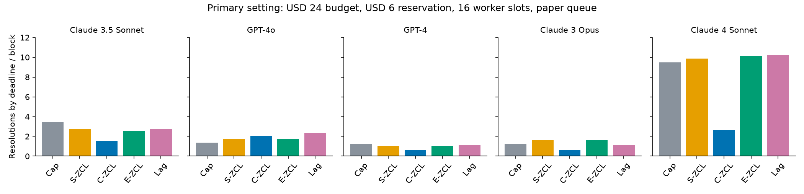

# Lagged budget audit

Reproducible numerical checks and recorded SWE-agent trace replay for **Online
Knapsack When the Price Lags: Metering Shared Budgets for Concurrent LLM Agents**.
The public release is authorized by the user's direct request of 2026-10-16.

**Results are mixed.** Under the predeclared primary setting, structural lag-aware
pricing averages **3.525 resolutions/block**, compared with **1.475** for committed
ZCL, **3.400** for expected-in-flight ZCL, and **3.375** for a hard cap. Rechecking
prices after refunds raises committed ZCL to **3.375**. On the common-complete
issue subset, lag-aware is **3.375** versus expected-in-flight ZCL's **3.450**.
The large gain over committed ZCL in one queue is not a universal new-policy gain.

Read the [revised paper](paper/revised-paper.pdf), [results](docs/RESULTS.md),
[claim audit](docs/CLAIM_AUDIT.md), [frozen protocol](docs/EXPERIMENT_PROTOCOL.md),
[data audit](docs/DATA_AUDIT.md), and [theory audit](docs/THEORY_AUDIT.md).



## What was actually run

- **2,398 usable recorded runs** from 2,404 available trajectories, on the same
  500 benchmark issues. There are 96 missing trajectories plus six unknown-outcome
  exclusions. This is independent implementation, not independent benchmark data.
- **107,160** final single-submission policy/block episodes, including 400 primary
  episodes; **648** pooling episodes; **1,920** model-switch episodes across 60
  scenarios; and **400** common-complete-issue sensitivity episodes.
- **9,000** randomized theory instances plus **2,500** adaptive search instances,
  45 independently integrated DDE checks, 500 additional oracle cross-checks,
  108 band checks, 120 convergence cases, and 18 coarse-item constructions.
- **74 tests pass.** CI runs deterministic fixtures only. The frozen experiment
  commit is `6a3dfd25029bbb5c4f0e3f6ab43cc12e06536dc8`;
  [its CI passed](https://github.com/fermibubble/lagged-budget-audit/actions/runs/38846515542).
- A separate validation inspected **9,930,622 ledger events**, with zero budget,
  ledger, or feedback-provenance violations. No paid model calls or fresh
  SWE-agent executions were made. Finite checks are not proofs.

## Reproduce offline

Python 3.11, a virtual environment, and the committed numeric measurements are
sufficient. No GitHub/Hugging Face credentials or raw issue text are required.

```bash
python3 -m venv .venv
source .venv/bin/activate
python -m pip install -r requirements.lock
python -m pip install --no-deps -e .
python -m pytest -q
python scripts/prepare_public_data.py
python -m lag_audit.campaign --data-root data/public --allow-incomplete \
  --output results/reproduced-campaign
```

`--allow-incomplete` explicitly acknowledges the documented complete-case analysis.
Results directories are never silently overwritten. A typical complete single-
submission campaign in the recorded environment took several minutes for all five
submissions; elapsed time depends on hardware. Dependency versions and environment
are in [requirements.lock](requirements.lock) and
[environment.json](results/environment.json). Bitwise equality across BLAS/platform
implementations is not promised; numerical comparisons should allow roundoff.

For a quick real-data check, add `--primary-only` and optionally
`--submission 20240620_sweagent_claude3.5sonnet` with a new output directory.
The full campaign is generated by `lag_audit.campaign.scenarios`; the readable
configuration export is [configs/campaign.json](configs/campaign.json), where a
null deadline means no deadline. Early smoke runs are retained separately and
are not independent replications.

Run `python scripts/pooling.py` and `python scripts/switches.py` for the declared
extensions after preparing public data. These scripts deliberately require new
`results/pooling` and `results/switches` directories. In a fresh reproduction
checkout, move the committed result directories aside first, or change the output
path variables; never discard an existing result without preserving it.
The single-submission event/training logs are compressed in ignored `data/ledger/`.
They can be regenerated from the public measurements; compact episode CSVs and
source locks are committed. The summary script reads the named final run and
requires a new `results/summary` directory.

## Re-ingest the public sources

This is optional for offline replay. It independently checks the published
measurements against public archives; no downloaded code or patch is executed.

```bash
python scripts/fetch_archives.py
# The 2025 archive exceeds the 1 GB full-download guard; preserve that failure.
python scripts/fetch_metadata_ranges.py
python scripts/validate_metadata.py
python scripts/data_audit.py
python scripts/prepare_public_data.py
```

The full acquisition script intentionally stops at the fifth archive's size guard.
The range adapter then retrieves complete root `info` metadata from HTTP suffixes.
Source locks identify original object sizes/ETags, fetched byte ranges, SHA256
hashes, immutable dataset/metadata revisions, parser decisions and exclusions.
The 2025 range hashes are **not** full-trajectory hashes. See
[deviations](docs/DEVIATIONS.md) for preserved failures and scope changes.

The public numeric records include costs, outcomes, call counts, IDs, repository,
PR creation timestamps and derived issue lengths. They do not include benchmark
issue text, reference patches, difficulty annotations, raw trajectories or the
original manuscript. No blanket redistribution license for those raw contents
was established. No software license is chosen on the authors' behalf.

## Theory and paper

```bash
python -m lag_audit.cli theory --instances 3000 --seed 20261014 \
  --output results/reproduced-theory
python scripts/theory_extended.py --output results/reproduced-theory-extended
# The following fixed paths must also be new for reruns:
python scripts/falsify.py
python scripts/coarse_grid.py
```

The repaired coarse example explicitly adds a 0.001 filler; the literal example
has ratio 5.667 instead of 12.982. At delay 1/2, `beta=sqrt(8R)-2` demonstrates
that the claimed constant-factor improvement wording cannot hold uniformly in R.
No numerical theory violations were found under the tested assumptions.

The editable manuscript source is [revised-paper.tex](paper/revised-paper.tex).
`python scripts/build_paper.py` builds it from the result tables and template.
Compile with Tectonic 0.17.0 or a compatible LaTeX installation:

```bash
tectonic --untrusted --outdir paper paper/revised-paper.tex
```

The original pooled/64-worker numbers and 58% LLM-triage claim are not certified.
The revised manuscript replaces unsupported empirical headlines with measured
results and explicit limits. It does not imply subsequent author review, fresh
agent execution, production deployment, independent test populations or formal
proof verification.
